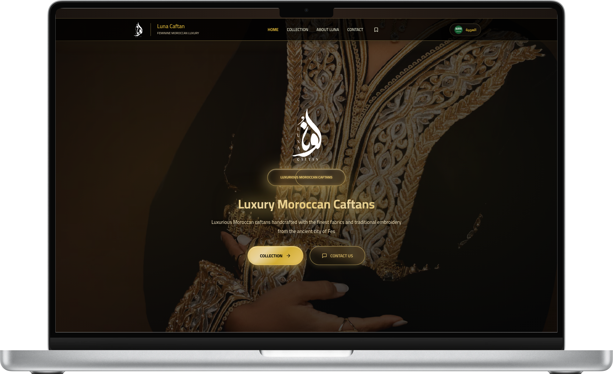
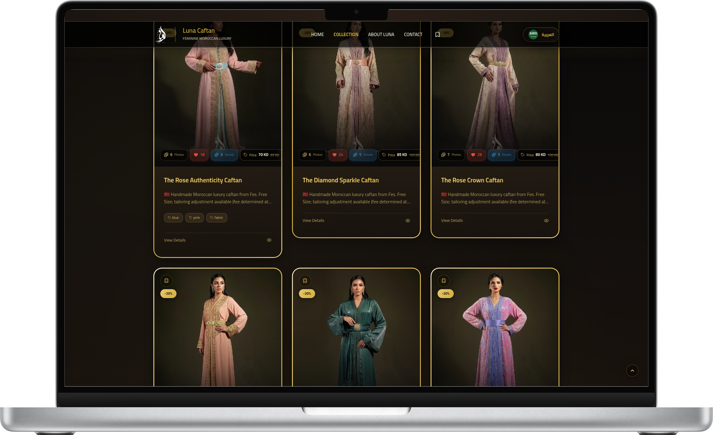
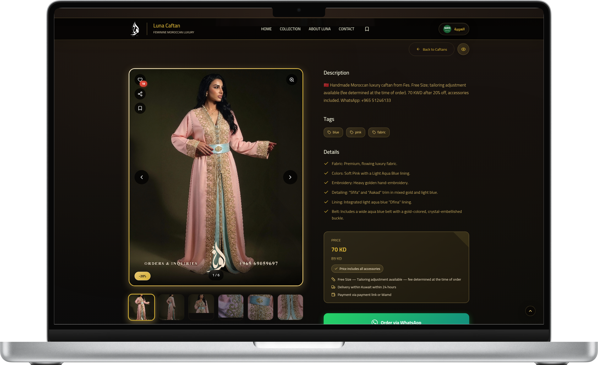
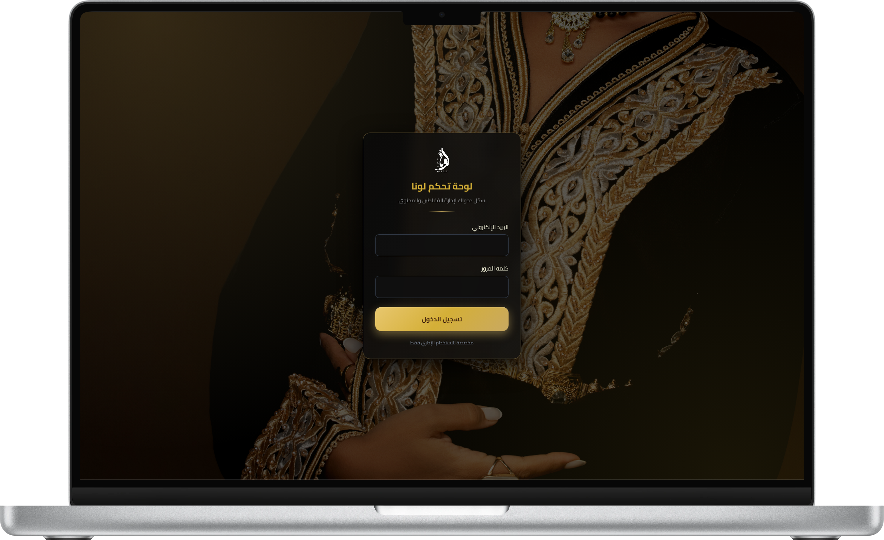
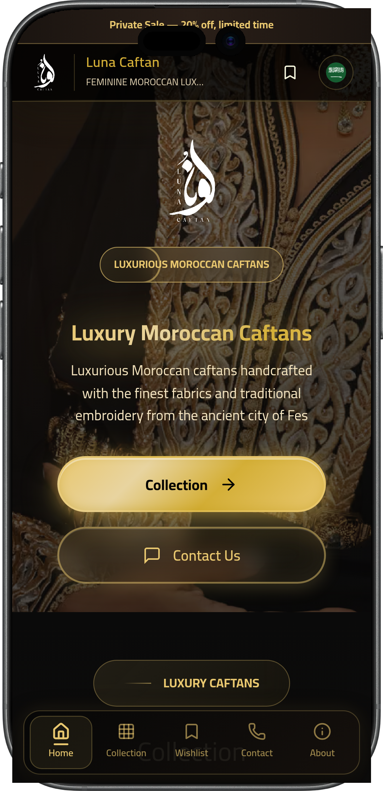
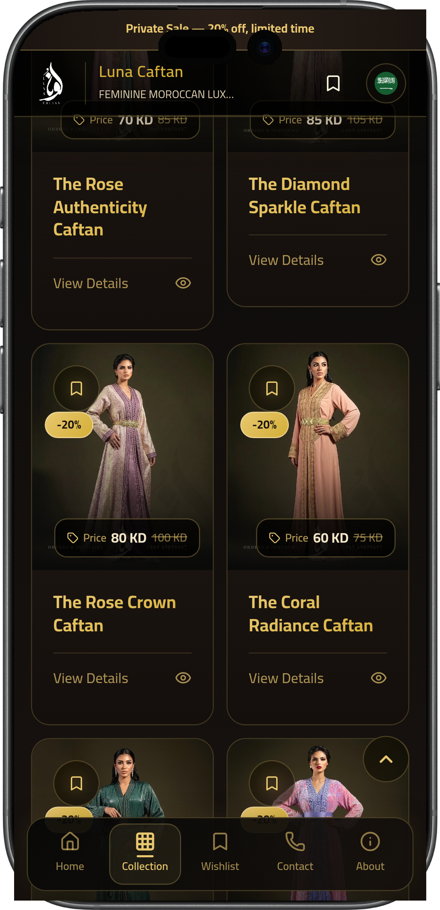
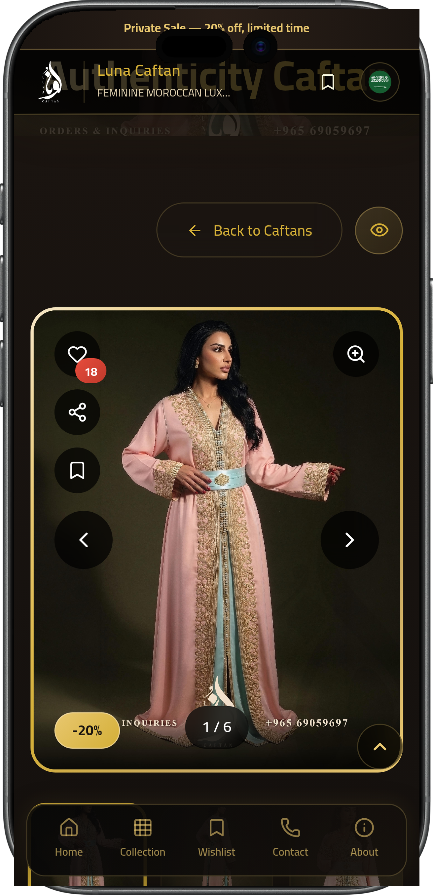

# Luna Caftan — لونا قفطان

**A bilingual (Arabic / English) e-commerce storefront and admin CMS for a luxury Moroccan caftan boutique — handcrafted caftans from Fes, sold in Kuwait.**

[](https://luna-caftan.vercel.app)



Luna Caftan is a real, live client project: a complete online boutique with a
product catalogue, sale campaigns, WhatsApp ordering, a customer inquiry inbox,
visitor analytics, and a full Arabic admin panel to run it all — no code changes
needed for day-to-day operations.

## Highlights

- **Bilingual storefront (AR / EN)** — one-tap language switch with full RTL
  layout in Arabic and LTR in English; every product, tag, and page is stored
  and rendered in both languages.
- **Collection experience** — searchable catalogue with featured filtering,
  grid/list views, live counts, likes, and a wishlist.
- **Rich product pages** — multi-photo gallery, bilingual descriptions and
  detail lists, tags, sale pricing with campaign banners (e.g. a timed
  “Private Sale −20%”), and an **Order via WhatsApp** deep link that carries
  the product context into the chat.
- **Inquiries inbox** — contact form for general questions or per-product
  inquiries; messages are stored, emailed to the boutique (SMTP), and tracked
  in the admin with read/status states.
- **Admin CMS** — secure sign-in (NextAuth credentials + bcrypt) to manage
  products (photos, prices, featured/active flags, bilingual fields), site
  settings (titles, logo, WhatsApp number, Instagram, email), and campaigns.
- **Visitor analytics** — built-in session/visit tracking with country
  detection and per-page view counts, surfaced in the admin dashboard.
- **Mobile-first** — app-like bottom navigation on phones, PWA manifest and
  service worker, and performance-minded image delivery via Cloudinary.

## Gallery

### Desktop

| Home | Collection |
| --- | --- |
|  |  |

| Product page | Admin sign-in (لوحة تحكم لونا) |
| --- | --- |
|  |  |

### Mobile

| Home | Collection | Product |
| --- | --- | --- |
|  |  |  |

## Tech stack

| Layer | Technology |
| --- | --- |
| Framework | Next.js 16 (App Router) · React 19 · TypeScript |
| Styling | Tailwind CSS 4 |
| Data | PostgreSQL · Prisma 6 (Admin, Product, Settings, ContactMessage, VisitorSession/Visit) |
| Auth | NextAuth 4 (credentials, bcrypt, JWT sessions) |
| Media | Cloudinary (product galleries) · UploadThing (admin uploads) |
| i18n | i18next / react-i18next with a custom language context + full RTL |
| Motion / UI | Framer Motion · Lucide icons |
| Email | Nodemailer (SMTP) for inquiry notifications |
| Hosting | Vercel |

## Running locally

```bash
npm install
npx prisma generate
npm run dev        # http://localhost:3000
```

Create a `.env` file with the following variables (values are environment-specific
and never committed):

```dotenv
DATABASE_URL=           # PostgreSQL connection string
NEXTAUTH_URL=           # e.g. http://localhost:3000
NEXTAUTH_SECRET=        # random secret for NextAuth
ADMIN_EMAIL=            # initial admin account (scripts/create-admin.ts)
ADMIN_PASSWORD=         # initial admin password
CLOUDINARY_URL=         # media library
SMTP_HOST=              # inquiry notification mail
SMTP_PORT=
SMTP_USER=
SMTP_PASS=
SMTP_FROM=
```

Seed helpers live in `scripts/` (`create-admin.ts`, `migrate-products.ts`,
`setup-settings.ts`, runnable via the `setup:*` npm scripts).

## Notes

- Product photography and prices shown in the screenshots are the boutique's
  real, publicly displayed catalogue.
- The storefront defaults to English with an Arabic toggle (العربية) in the
  header; the admin panel is Arabic-first.
